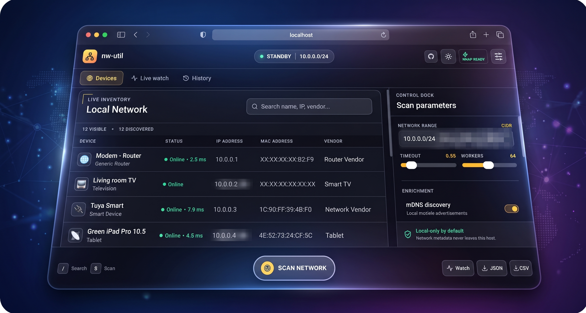

# nw-util

<p align="center">
  
</p>

`nw-util` is a fast, colorful, and privacy-friendly network scanner and operator console for devices on your local IPv4 network. It pings the active subnet, reads the operating system's neighbor/ARP table, and presents the results in a sleek terminal interface or a modern browser-based web dashboard.

```text
╭──────────────────┬──────────────┬─────────────┬────────────┬───────────────────┬────────╮
│ TYPE             │ NAME / MODEL │ STATUS      │ IP ADDRESS │ MAC ADDRESS       │ VENDOR │
├──────────────────┼──────────────┼─────────────┼────────────┼───────────────────┼────────┤
│ 🌐  Router       │ gateway      │ Online      │ 10.0.0.1   │ 00:11:22:33:44:55 │ ...    │
│ 💻  Computer     │ macbook      │ This device │ 10.0.0.8   │ ...               │ ...    │
╰──────────────────┴──────────────┴─────────────┴────────────┴───────────────────┴────────╯
```

## Install

Python 3.10 or newer is required. Python 3.13 is recommended for the current macOS development machine because its Homebrew Python 3.15 installation has an upstream `ensurepip` issue. Runtime Python dependencies are FastAPI, Uvicorn, and `zeroconf`.

```bash
python3.13 -m venv .venv
source .venv/bin/activate
python -m pip install -e .
nw-util
```

### Raspberry Pi OS / Debian / Ubuntu

```bash
sudo apt update
sudo apt install -y python3-venv iproute2 iputils-ping
python3 -m venv .venv
source .venv/bin/activate
python -m pip install -e .
nw-util
```

For richer vendor and service identification, install the optional local tool:

```bash
sudo apt install -y nmap
nw-util --deep
```

The application code is pure Python and works on both 32-bit and 64-bit Raspberry Pi OS. Root privileges are not required to run it; Nmap enrichment uses an unprivileged TCP connect scan.

To expose the command globally from a checkout on Linux, link the virtual-environment entry point into a directory already on `PATH`:

```bash
mkdir -p "$HOME/bin"
ln -s "$PWD/.venv/bin/nw-util" "$HOME/bin/nw-util"
```

On some Linux systems, installing `ieee-data` adds manufacturer names. Without a local OUI database the vendor column remains blank; no MAC address is sent to an internet service.

## Usage

```bash
# Scan the automatically detected LAN
nw-util

# Scan an explicit subnet
nw-util --network 10.0.0.1/24

# Resolve local names and probe common services (uses Nmap when installed)
nw-util --deep

# Browse mDNS/DNS-SD advertisements
nw-util --discover

# Filter, sort, and export
nw-util --type printer --sort latency
nw-util --vendor raspberry --format csv > devices.csv
nw-util --filter living-room --format json

# Save a friendly name by IP, MAC, or hostname
nw-util alias AA:BB:CC:DD:EE:FF "Desk Raspberry Pi"
nw-util unalias AA:BB:CC:DD:EE:FF

# View persistent first/last-seen history
nw-util history
nw-util history "Desk Raspberry Pi" --json

# Continuously report joins, departures, and metadata changes
nw-util watch --discover --interval 15

# Build a device security profile (inspect remains an alias)
nw-util security 10.0.0.1
nw-util security "Desk Raspberry Pi" --json
nw-util inspect 10.0.0.1

# Add privileged TCP/IP OS fingerprinting when intentionally run as root
sudo .venv/bin/nw-util security 10.0.0.1 --os-detect

# Export results
nw-util --json > devices.json

# Disable styling
NO_COLOR=1 nw-util
```

Run `nw-util --help` for timeout, concurrency, and host-limit controls.

## Web operator console

`nw-util` includes a local web interface for the same scanner, history, alias, watch, export, and security-profile workflows:

When running from a fresh source checkout, build the frontend once before starting the web server (Node.js 20 or newer is required):

```bash
cd web
npm ci
npm run build
cd ..
```

The command-line scanner can be installed and used without this build. A release wheel must be built after the frontend so that it includes the web assets.

```bash
nw-util web
```

Open [http://10.0.0.1:8765](http://10.0.0.1:8765). The server binds to loopback by default, so network metadata remains available only on the machine running `nw-util`. Exposing it to another interface requires an explicit `--host` value and is not recommended without additional access controls.

To reach the web UI from other devices on your local network:

```bash
.venv/bin/nw-util web --host 0.0.0.0 --port 8765
```

The interface provides:

- bounded network scans with mDNS and optional Nmap enrichment;
- device search, filters, sorting, and JSON/CSV downloads;
- persistent friendly names and first/last-seen history;
- a continuous live-change feed;
- per-device, unprivileged security profiles.

### Frontend development

Node.js 20 or newer is required to build the frontend. With the Python API running on port 8765:

```bash
cd web
npm install
npm run dev
```

Vite serves the development UI at `http://10.0.0.1:5173` and proxies `/api` to the Python service. `npm run build` writes production assets into `src/nw_util/web_dist`; build these assets before producing a release wheel. End users installing a built wheel do not need Node.js.

## Accuracy and permissions

- Device type is a best-effort guess based on the hostname and locally available manufacturer data.
- Device history is stored with user-only permissions at `$XDG_STATE_HOME/nw-util/state.json`, or `~/.local/state/nw-util/state.json` when `XDG_STATE_HOME` is unset. Set `NW_UTIL_STATE_PATH` to override it.
- mDNS/DNS-SD discovery stays on the local link and uses the cross-platform `zeroconf` package.
- `--deep` checks common service ports and may take longer. Install Nmap with `brew install nmap` on macOS or `sudo apt install nmap` on Debian-based Linux; it also supplies a local vendor database.
- `security` (`inspect` alias) is a bounded, read-only TCP service profile covering open ports, products, versions, CPE identifiers, probable OS evidence, and notable LAN exposure. Full TCP/IP OS fingerprinting is opt-in with `--os-detect` and only runs when the process already has root privileges. Its observations do not prove that a service is secure or vulnerable.
- Exact model names usually are not advertised on a network, so the `NAME / MODEL` field falls back to the hostname, vendor, or `Unknown`.
- Modern phones often use randomized MAC addresses; these are identified as private rather than assigned a misleading vendor.
- The tool reports devices that answer a probe or remain in the computer's neighbor cache. Firewalls, client isolation, VLANs, and sleeping devices can make hosts invisible.
- Root is not required. The scanner uses the system `ping`, `arp`, `ip`, `route`, `ifconfig`, and `ipconfig` commands when available.

Only scan networks you own or have permission to inspect.

## Development

```bash
python -m unittest discover -s tests
```
